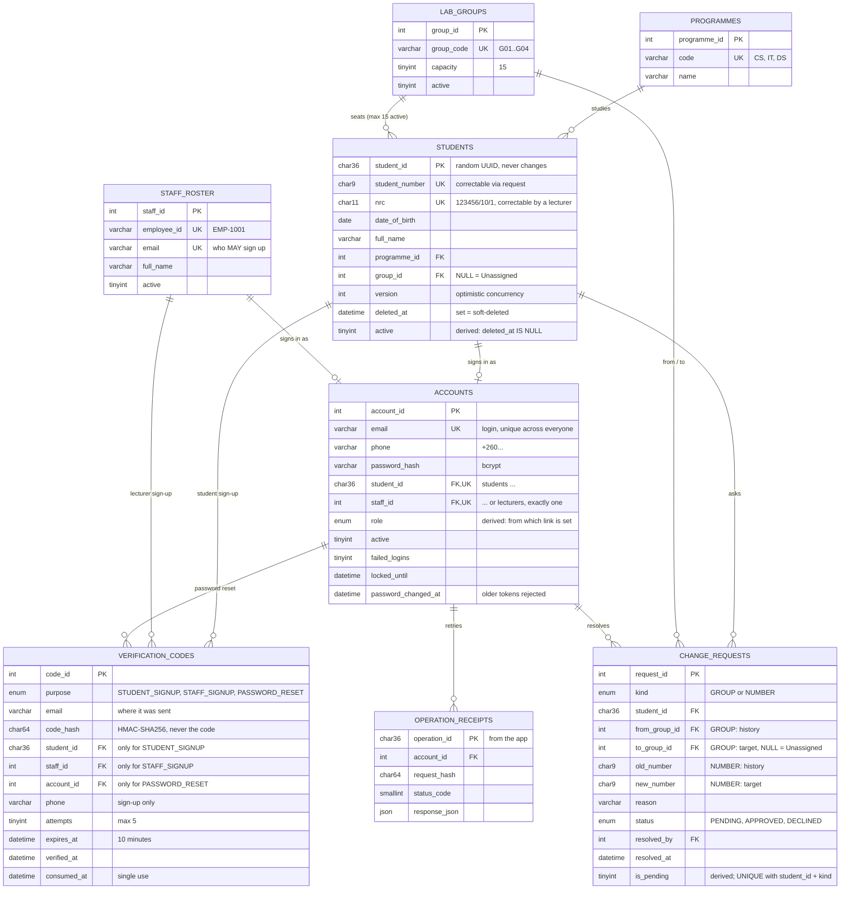

# ER diagram

Paste the block into any Mermaid renderer (GitHub shows it automatically, or
use https://mermaid.live). Columns marked *derived* are MySQL generated
columns: the database computes them from other columns, nobody writes them.

## Rules the database itself enforces

| Rule | How |
|---|---|
| A student number, and an NRC, belongs to one person forever (even after deletion) | `UNIQUE` on `students.student_number` and `students.nrc`; soft delete keeps the row |
| NRC and student number have the right shape | `CHECK` with a regular expression |
| One login per student, one per lecturer, one per email | `UNIQUE` on `accounts.student_id`, `staff_id`, `email` |
| An account is a student's or a lecturer's, never both or neither | `CHECK ((student_id IS NULL) <> (staff_id IS NULL))`; `role` is derived from it |
| A verification code is linked to exactly the person its purpose needs | `CHECK chk_vcode_link` |
| One open request per student per kind | `UNIQUE (student_id, kind, is_pending)`; `is_pending` is NULL once resolved |
| A request's shape matches its kind; resolved requests have a resolved time | `CHECK chk_creq_shape`, `chk_creq_resolved` |
| Nothing can point at a row that does not exist | Foreign keys everywhere |
| At most 15 active students per group | Not a constraint (MySQL cannot count in a CHECK): one locked transaction in `services/group.service.js` that every path uses |

## Why `student_id`, not the NRC, is the primary key

The NRC is unique for every citizen, so it is `UNIQUE NOT NULL`. It is not the
primary key because a primary key must never change (an NRC can be typed wrong
and need correcting) and is copied into every foreign key, URL and log line,
where a national ID number should not be. `student_id` is a random UUID that
never changes; the NRC is a unique, correctable field next to it.
